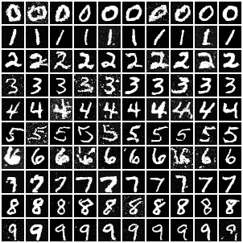
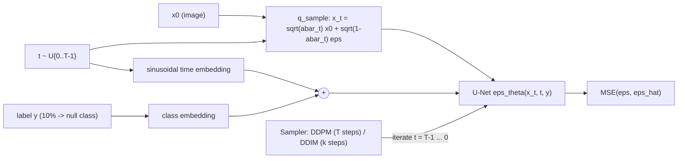
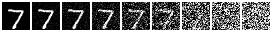
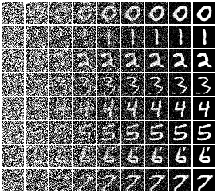

# ddpm-diffusion-from-scratch

A **denoising diffusion model implemented from scratch in PyTorch**: noise schedules, closed-form forward process, a U-Net noise predictor with time and class conditioning, EMA, **DDPM ancestral sampling**, **DDIM** fast sampling, and **classifier-free guidance**, trained on MNIST on a laptop CPU.

[](https://github.com/Alkarim786/ddpm-diffusion-from-scratch/actions/workflows/ci.yml)


> Project 22 of Karim's 30 Days, 30 Projects series.



*100 samples, one class per row (0-9), DDIM 50 steps, guidance w = 2, from a 0.28M-parameter model trained for 5,000 steps (about 5 epochs) on CPU. Some speckle noise remains: see "Limitations".*

## Why this exists

Diffusion models power modern image, audio and video generation. Using a library hides the interesting parts, so this repo builds every piece: the maths of the forward and reverse processes, why the network predicts noise, how DDIM turns a stochastic sampler into a deterministic one, and how classifier-free guidance trades diversity for fidelity, each backed by tests and measurements.

## Architecture



**Training.** Sample an image, a random timestep and Gaussian noise; jump straight to x_t with the closed form (no need to simulate t steps); ask the U-Net to predict the noise; minimise the MSE (the simplified DDPM objective, which is a re-weighted ELBO). With probability 0.1 the label is replaced by a "null" class, so one network learns both the conditional and unconditional noise predictions.

**Sampling.** Start from pure noise and iterate backwards. *DDPM* draws x_{t-1} from the Gaussian posterior (mean from the predicted x0 and x_t, variance from the schedule), one step per training timestep. *DDIM* uses a sub-sequence of timesteps and, with eta = 0, a deterministic update, so 50 steps (or fewer) replace 1,000. *Classifier-free guidance* combines the two predictions: eps = (1 + w) eps(x, y) - w eps(x, null).

**U-Net.** Residual blocks (GroupNorm + SiLU + 3x3 conv) with the time+class embedding projected and added in every block; stride-2 conv down-sampling, nearest-neighbour + conv up-sampling, skip connections by concatenation; self-attention at 7x7 and in the bottleneck; zero-initialised output convs so every block starts as the identity.

## Tech stack

| Choice | Why |
|---|---|
| PyTorch (CPU-first, GPU-ready) | Plain tensors and autograd; the same code scales to GPU by changing `--base/--steps/--batch`. |
| Cosine beta schedule (linear also implemented) | Destroys information more gradually than linear, which matters for small images (tested). |
| Epsilon-prediction + L_simple | Stable, scale-free target; equivalent to score matching. |
| EMA of weights | Measurably better samples than the raw weights (see results). |
| DDIM | 20x+ faster sampling with no retraining. |
| Own classifier for metrics | Inception-based FID is not meaningful for 28x28 digits; see the metric caveat below. |

## Features (implemented)

- Linear and cosine schedules with all derived constants (alpha-bar, posterior mean/variance)
- Closed-form forward process; epsilon-prediction loss; label dropout for guidance
- U-Net with time/class conditioning and attention; EMA with warm-up
- DDPM ancestral sampler (with optional trajectory capture) and DDIM sampler (eta configurable)
- Classifier-free guidance
- Evaluation: classifier-based FID-proxy, label agreement, guidance sweep, EMA-vs-raw, sampler comparison, clean timing script
- Figures: forward noising strip, reverse-denoising trajectories, class-conditional sample grid

## Roadmap (not built)

- CIFAR-10 / larger models (needs a GPU; the CPU budget here only allows MNIST-scale)
- v-prediction parameterisation, learned variances, NLL (bits/dim) bound
- Latent diffusion, EMA-halving schedules, mixed precision
- Real FID with Inception features on a colour dataset

## Quick start

```bash
python -m venv .venv && source .venv/bin/activate       # Windows: .venv\Scripts\activate
pip install torch torchvision --index-url https://download.pytorch.org/whl/cpu
pip install numpy scipy matplotlib pytest ruff
python -m ddpm.train --steps 5000 --out runs/mnist       # ~1 hour on a 4-core laptop CPU, downloads MNIST
python -m ddpm.evaluate --ckpt runs/mnist/ckpt.pt --out docs
python -m ddpm.bench_sampling                            # clean sampler timings
```

Docker (CPU): `docker compose run --rm train` then `docker compose --profile eval run --rm evaluate`. CI builds the image on every push. I did not run the container end-to-end for training locally, since training takes about an hour.

Sampling from code:

```python
from ddpm.evaluate import load_model
from ddpm.diffusion import Diffusion
from ddpm.schedule import Schedule
import torch

model, ck = load_model("runs/mnist/ckpt.pt")
d = Diffusion(model, Schedule(ck["cfg"]["T"], ck["cfg"]["schedule"]))
x = d.ddim_sample((10, 1, 28, 28), steps=50, eta=0.0, y=torch.arange(10), guidance=2.0)   # digits 0..9
```

### Scaling up on a GPU

`python -m ddpm.train --base 64 --mults 1 2 2 --num-res 2 --steps 60000 --batch 128 --lr 2e-4` (about 8M parameters). For CIFAR-10 change `in_ch`, `image_size` and the dataset loader (3 channels, 32x32, `--mults 1 2 2 2`).

## Testing

```bash
pytest -q        # 24 tests, ~3 minutes on CPU (the overfit and sampler tests do real optimisation / 200-step sampling)
ruff check .
```

| Test | What it proves |
|---|---|
| Schedule properties | alpha-bar strictly decreasing in (0,1), ends near 0; posterior variance <= beta; cosine is gentler early than linear |
| q_sample statistics | empirical mean/variance match the closed form at several t; x_999 is ~N(0,1) |
| U-Net shapes | output equals input shape for 16/28/32 px, with and without classes; labels actually influence the output |
| Overfit single image | training loss drops by > 40% in 150 steps, so gradients and loss are wired correctly |
| Oracle sampler tests | with a *perfect* noise predictor, DDPM (linear and cosine) and DDIM (5 and 50 steps) recover x0 to within 0.05: this validates the sampler algebra independently of any training |
| Seeded determinism | same seed gives the same DDPM/DDIM output; DDIM eta = 0 is deterministic, eta = 1 is not |
| CFG | null-class dropout rate matches `p_uncond`; the guidance formula is exactly (1+w) cond - w uncond |
| EMA, Frechet distance | EMA converges to the weights; FD is 0 for identical stats and ~5 for a unit shift in 5 dims |

Tests ran locally (Windows, Python 3.13, torch 2.15 CPU) and in CI on Ubuntu, which also smoke-trains 20 steps.

## Results (measured on this PC)

Hardware: AMD Ryzen 5 7520U (4 cores / 8 threads), 15.2 GB RAM, CPU only, 4 torch threads, Windows 11. Single training run, seed 0. Raw numbers: [docs/eval.json](docs/eval.json), [docs/sampling_timing.json](docs/sampling_timing.json), [docs/loss.csv](docs/loss.csv).

**Training.** 280,881 parameters (base width 16, widths 16/32/32, one ResBlock per level), T = 1000, cosine schedule, batch 64, lr 3e-4, EMA 0.995, 5,000 steps (5.3 epochs). Loss 0.74 (step 50) -> 0.062 (step 500) -> 0.042 (step 5000). About **0.76 s/step, about 62 minutes of compute**, computed from `loss.csv` after excluding a gap where the laptop went to sleep. (`train_meta.json` records 50,358 s because it includes that sleep; ignore that figure.)

**Metric caveat.** "FID-proxy" is the Frechet distance between feature statistics of real and generated digits, using the 64-d penultimate layer of a small CNN trained here (98.3% MNIST test accuracy). It is **not** comparable to published FID. To give it scale: real train vs real test = **17.2** (floor), Gaussian noise vs real = **794** (ceiling), n = 1000.

**Guidance sweep** (DDIM 50 steps, 1,000 samples, 100 per class):

| Guidance w | Label agreement (classifier) | Mean confidence | FID-proxy |
|---|---|---|---|
| 0 (no guidance) | 80.2% | 0.904 | 25.4 |
| 1 | 98.0% | 0.977 | **20.5** |
| 2 | 99.7% | 0.991 | 30.3 |
| 4 | 100% | 0.997 | 48.6 |

More guidance makes samples more clearly the requested class but less diverse and, past w = 1, farther from the real distribution (higher FID-proxy). This is the classic fidelity/diversity trade-off. The 80% label agreement at w = 0 also shows how under-trained the conditional model is, and guidance corrects most of it.

**EMA vs raw weights** (DDIM 50, w = 2): FID-proxy 30.3 (EMA) vs 38.5 (raw).

**Sampler speed** (16 images, w = 2, clean run, warmed up):

| Sampler | Time for 16 images | Per image |
|---|---|---|
| DDPM, 1000 steps | 252.6 s | 15.8 s |
| DDIM, 50 steps | 11.8 s | 0.74 s |
| DDIM, 20 steps | 6.6 s | 0.41 s |
| DDIM, 10 steps | 4.3 s | 0.27 s |

DDIM-50 is **21x faster** than DDPM-1000. Sample quality on 128 images (FID-proxy, floor at n = 128 is 46.1): DDPM-1000 96.1, DDIM-50 79.2, DDIM-20 76.4, DDIM-10 71.0, with label agreement 100% / 100% / 100% / 99.2%. In this single-seed, n = 128 comparison the few-step DDIM samples are *not* worse than DDPM; I would not read a ranking into differences this small. A plausible (untested) reason DDIM-10 does not lose is that deterministic sampling avoids re-injecting noise that this small model cannot fully remove.

DDIM with eta = 0 was verified deterministic on the trained model.




*Top: one test digit noised at t = 0, 50, 100, 200, 350, 500, 700, 850, 999. Bottom: DDPM reverse trajectories for digits 0-7 (columns are every 125 steps, left = noise, right = result).*

## Key engineering decisions and trade-offs

- **Predict noise, not the image.** The target has unit variance at every t, so one loss scale works across timesteps; x0 is recovered algebraically and clipped to [-1, 1] before forming the posterior mean (stabilises sampling).
- **Cosine over linear.** The linear schedule makes the last ~20% of steps nearly useless on small images; cosine spreads information destruction more evenly.
- **Zero-init residual outputs.** Each block begins as the identity, which makes early training stable. A test caught the side effect that class conditioning is inert at initialisation until the weights move.
- **Class dropout + guidance in one network** instead of training a separate classifier; guidance costs two forward passes per step (batched together).
- **CPU budget.** The network is deliberately tiny (full-resolution convolutions dominate CPU cost: 1.1M params ran 1.5 s/step, so I chose 0.28M at 0.65-0.76 s/step) to fit about an hour of training.

## Limitations (honest)

- Small model, 5 epochs: samples are recognisable but speckled; stroke edges are noisy.
- One training run and one sampling seed per configuration; no confidence intervals. FID-proxy at n = 128 is biased and noisy.
- The metric uses my own classifier, so it measures "looks like MNIST digits to this CNN", not general image quality. No NLL/bits-per-dim was computed.
- Only MNIST was trained; Fashion-MNIST loading exists (`--dataset fashion`) but was not run.

## Project structure

```
ddpm/
  schedule.py   unet.py   diffusion.py   ema.py   data.py
  train.py      evaluate.py   bench_sampling.py   metrics.py
tests/test_ddpm.py
docs/   figures, eval.json, sampling_timing.json, loss.csv, train_meta.json
Dockerfile  docker-compose.yml  .github/workflows/ci.yml
```
